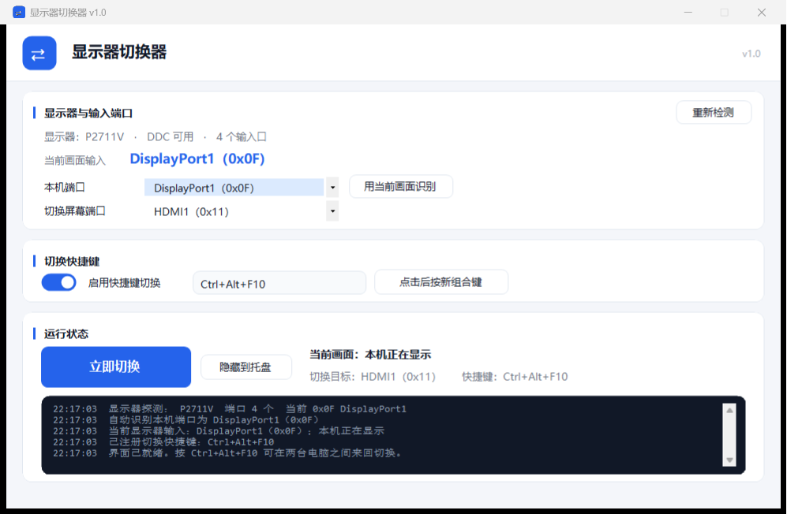

# 显示器切换器 · DisplayDock

> 一台多接口显示器接两台电脑，按一个快捷键就能把画面切到另一台，不用伸手去按显示器按钮。

**v1.0** · Windows 7 SP1 / 8.1 / 10 / 11 · .NET Framework 4.6+ · 单文件 55 KB



---

## 功能

- **显示器自动识别**：枚举物理显示器，读取 MCCS 能力字符串，列出真实可用的输入口（DisplayPort / HDMI / USB-C 等）；
- **一键切换**：在本机端口和另一台电脑的端口之间来回切，点按钮或按全局快捷键；
- **切换后校验**：写入后 1.8 秒回读显示器，区分“已生效 / 未见效 / 读不到”，最多重试 3 次；
- **自定义快捷键**：点击后直接按键录入，检测组合键占用（Win32 1409）；
- **托盘常驻**：隐藏到托盘，托盘菜单可切换/退出；
- **单实例**：重复启动会提示已在运行；
- **崩溃日志**：只写本地 `logs\error.log`。

程序只切换显示器的画面输入，不使用任何网络连接。

## 快速开始

1. 下载或编译 `DisplayDock.exe`，放到任意当前用户可写的目录（如 `D:\DisplayDock\`）；
2. 双击运行，确认顶部显示 `显示器：×× · DDC 可用 · N 个输入口`；
3. “本机端口”选本机显卡插的口，“切换屏幕端口”选另一台电脑插的口；
4. 点“立即切换”或按 `Ctrl+Alt+F10`。

详细步骤见 [使用说明.md](使用说明.md)，三分钟上手见 [安装说明.txt](安装说明.txt)。

## 从源码构建

只需要 Windows 自带的 .NET Framework 4.x C# 编译器，不需要安装 SDK：

```powershell
powershell -ExecutionPolicy Bypass -File .\build.ps1            # 编译 → dist\DisplayDock.exe
powershell -ExecutionPolicy Bypass -File .\build.ps1 -Test      # 编译 + 回归测试（含实机 DDC 探测）
powershell -ExecutionPolicy Bypass -File .\build.ps1 -Package   # 编译 + 打包 → dist\DisplayDock-v1.0.zip
```

回归测试覆盖配置读写、端口解析、快捷键解析、业务集成，并可选实机 DDC 读写。

## 目录结构

| 路径 | 说明 |
| --- | --- |
| `src\Program.cs` | 入口、单实例、崩溃日志 |
| `src\MainForm.cs` | 界面与托盘 |
| `src\AppService.cs` | 业务编排：扫描、端口、快捷键、切换、校验 |
| `src\MonitorSession.cs` | Win32 DDC/CI 会话（dxva2） |
| `src\PortCatalog.cs` | MCCS 端口名称与能力字符串解析 |
| `src\HotkeyManager.cs` | 快捷键解析与注册 |
| `src\UiTheme.cs` | 自绘控件与配色 |
| `src\Models.cs` | 配置、数据模型、日志出口 |
| `build.ps1` | 构建/测试/打包脚本 |
| `使用说明.md` / `安装说明.txt` | 用户文档 |

## 配置

配置文件 `displaydock.json` 位于 exe 同目录，首次修改设置后生成：

| 字段 | 说明 |
| --- | --- |
| `Version` | 配置版本，当前为 `1` |
| `MonitorKey` | 显示器唯一标识 |
| `LocalInput` | 本机端口（VCP 0x60 值），如 `15` = 0x0F = DisplayPort1 |
| `TargetInput` | 切换屏幕端口，如 `17` = 0x11 = HDMI1 |
| `Hotkey` | 快捷键文本，如 `Ctrl+Alt+F10` |
| `HotkeyEnabled` | 是否启用快捷键 |

该文件含本机显示器标识与端口，已加入 `.gitignore`，不随仓库分发。

恢复默认：删除 `displaydock.json`，或运行 `DisplayDock.exe --reset-config`。

## 许可

仓库暂未附带开源许可证；如需他人复用，请先补充 LICENSE。
